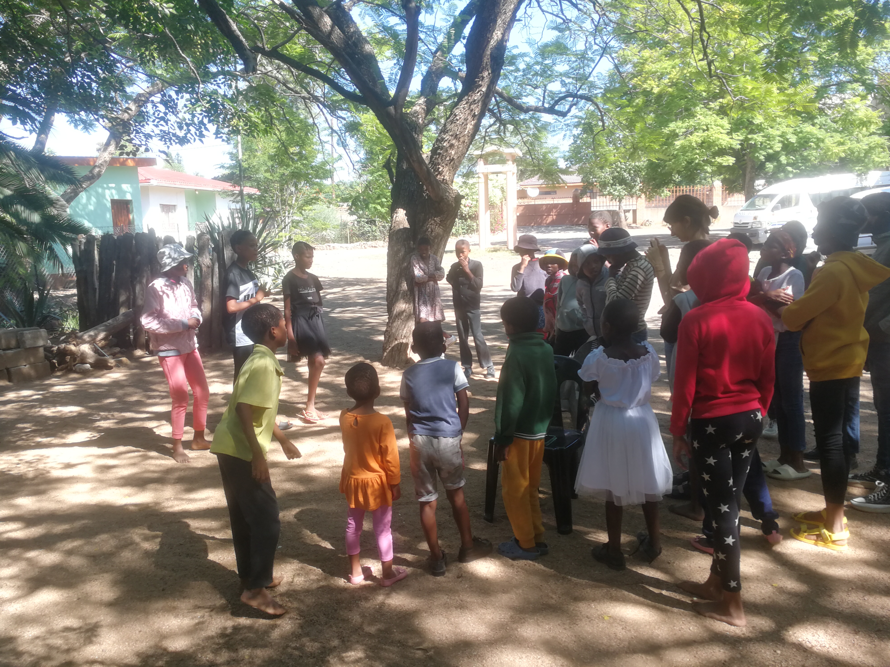

# Thulaganyo Phala Sehuhula

Botswana-based Managing Director and Principal Consultant at Unity Harvest Alliance (Pty Ltd), working at the intersection of data engineering, education, and institutional digital transformation.

📧 Email: [phalathulaganyo@gmail.com](mailto:phalathulaganyo@gmail.com)  
🔗 LinkedIn: [linkedin.com/in/thulaganyo-phala-sehuhula](https://www.linkedin.com/in/thulaganyo-phala-sehuhula)  
💻 GitHub: [github.com/unchained-angel](https://github.com/unchained-angel)

---

## About Me

I am a technologist, and founder with experience bridging technical delivery and leadership. My work focuses on using practical technology to solve real problems in agriculture, education, public-sector advisory, and organisational operations.

<table>
  <tr>
    <td>
      
    </td>
    <td>
      
    </td>
  </tr>
</table>

---
