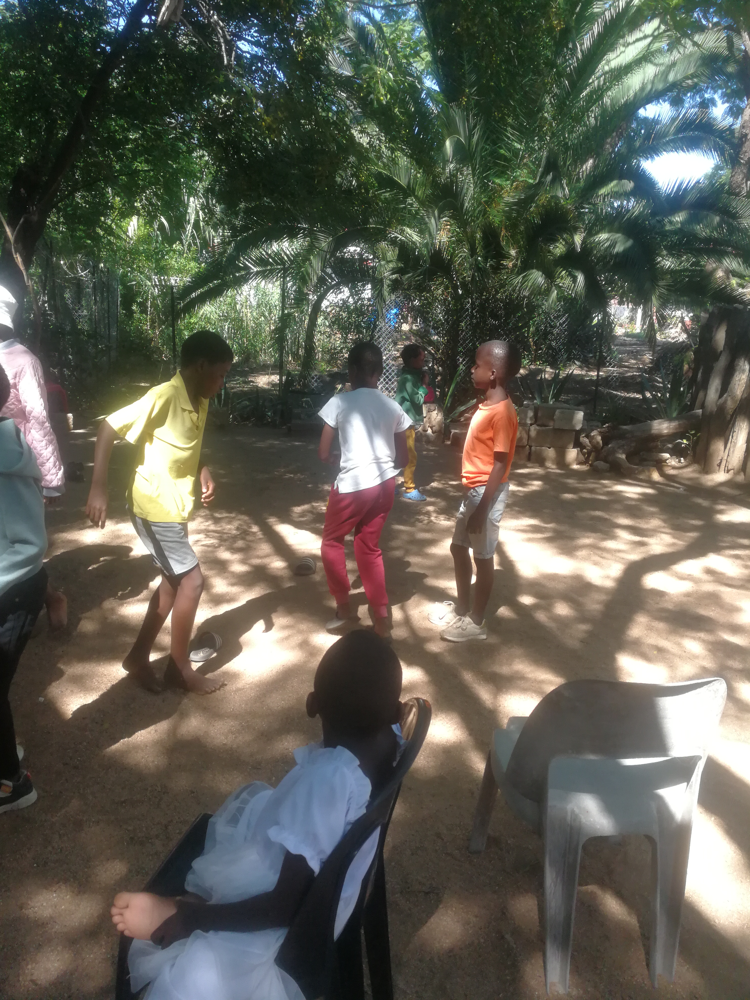

Hi! I'm Thulaganyo Phala, T.S. for short. I'm a technologist based in the rolling hills of Serowe, Botswana. Below you will find my work that tackles, infrastructure and engineering solutions to tackle digital inclusion in my home.

📧 Email: [phalathulaganyo@gmail.com](mailto:phalathulaganyo@gmail.com)  \
🔗 LinkedIn: [linkedin.com/in/thulaganyo-phala-sehuhula](https://www.linkedin.com/in/thulaganyo-phala-sehuhula)  \
💻 GitHub: [github.com/unchained-angel](https://github.com/unchained-angel)  \
<!-- 📄 CV: [View my CV](./assets/Thulaganyo-Phala-CV.pdf) -->

---

## About Me

I'm pursuing a Computer Science degree as I gain a deeper competency across software engineering and infrastructure. My long-term goal is a fluency in distributed systems engineering.

I'm also working on becoming an active contributor status across multiple open-source projects, such as Apache Beam/Dataflow, Kubernetes and Meshery. I get to learn from experienced engineers, work on real-world systems and grow my skills set through collaboration.

Outside of that, I'm hosting my inaugural **AI Unplugged Summer Session 2026**. Its about collaborating with children with limited access to computers and other digital resources. It explores ways to explore technology, through interactive physical games, engagement, and some computer time!

---

<table>
  <tr>
    <td>
      
    </td>
    <td>
      
    </td>
  </tr>
</table>

---
