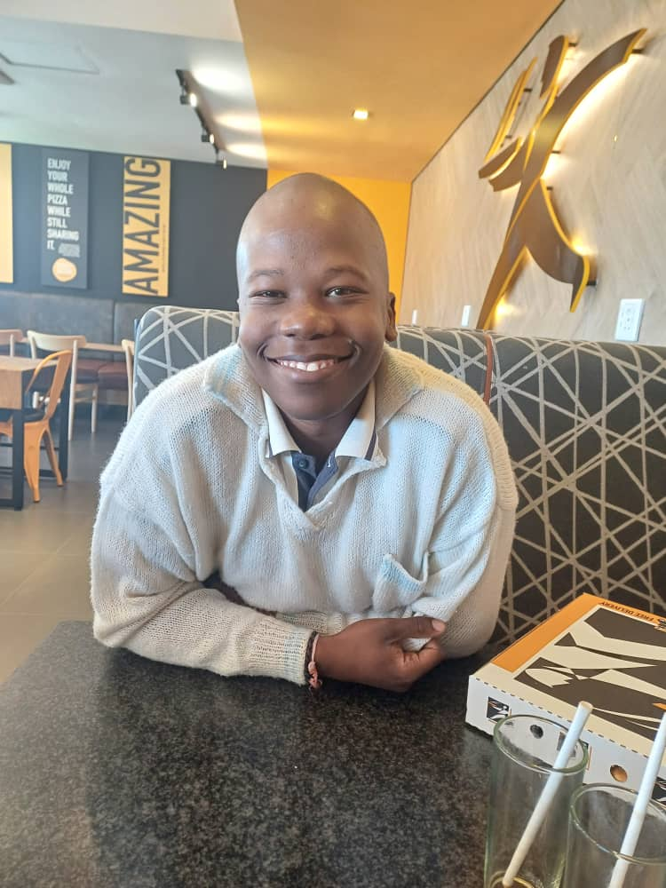

Hi! I'm Thulaganyo Phala, TS for short. I'm a technologist based in the rolling hills of Serowe, Botswana. Below you will find my work that tackles, infrastructure and engineering solutions to tackle digital inclusion in my home.

📧 Email: [phalathulaganyo@gmail.com](mailto:phalathulaganyo@gmail.com)  \
🔗 LinkedIn: [linkedin.com/in/thulaganyo-phala-sehuhula](https://www.linkedin.com/in/thulaganyo-phala-sehuhula)  \
💻 GitHub: [github.com/unchained-angel](https://github.com/unchained-angel)  \
<!-- 📄 CV: [View my CV](./assets/Thulaganyo-Phala-CV.pdf) -->

---

## About Me

I am a technologist, and founder with experience bridging technical delivery and leadership. My work focuses on using practical technology to solve real problems in agriculture, education, public-sector advisory, and organisational operations.

<table>
  <tr>
    <td>
      
    </td>
    <td>
      
    </td>
  </tr>
</table>

---
